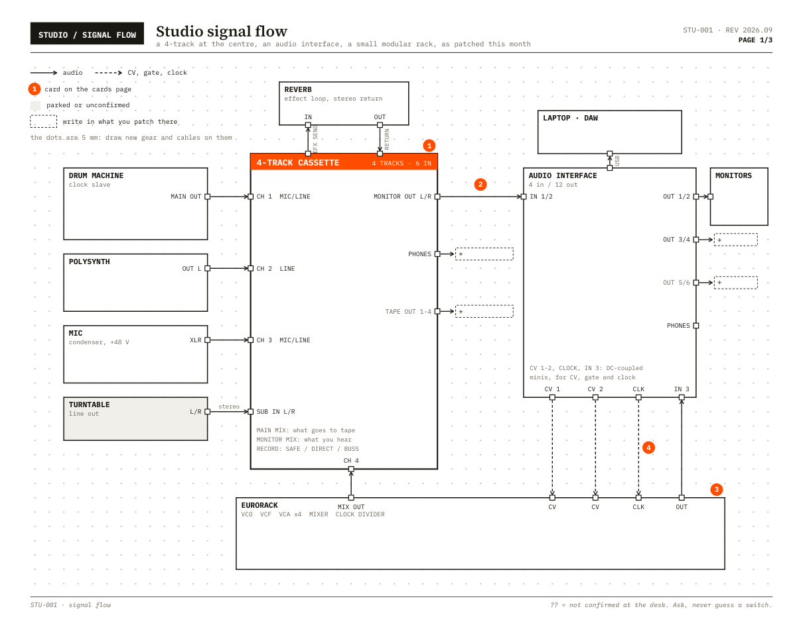
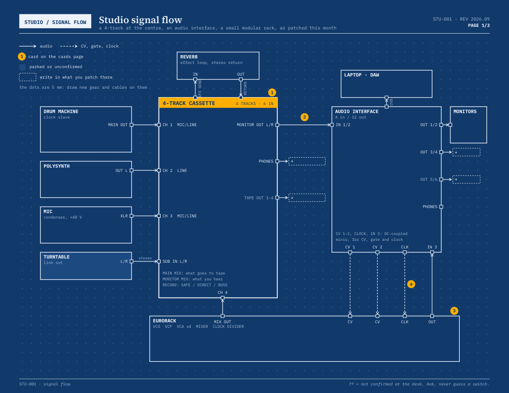
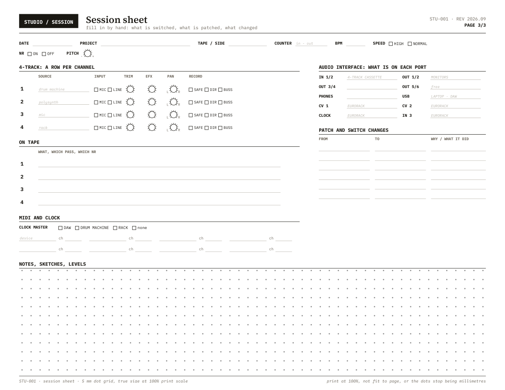

# studio-sheets

Describe your studio in one JSON file and print its signal flow on a millimetre dot grid,
with a session sheet to fill in by hand. It is a skill for Claude Code, and a plain
Python script you can run without it.

## What you get

- **The map.** Every device is a box on a 5 mm dot grid with its ports on its edges.
  Audio cables are solid and CV, gate and clock dashed. Every free port can carry a
  dashed box to write in whatever gets patched there next. The dots are true
  millimetres, so the printout doubles as graph paper.
- **The session sheet.** Header fields, a row per mixer channel with tick boxes and knob
  outlines to draw on, what is on each port (hinted from the map's cables), a changes
  table, clock and MIDI, and a dot-grid notes area. It is also written on its own, to
  print a stack of.
- **Cards**, if you want them: numbered rules for the room, matching badges on the map.

Five palettes. The three white-paper ones survive a mono laser; `violet` and `blueprint`
fill the page and are for screens.

## Install

    git clone https://github.com/hed0rah/studio-sheets ~/.claude/skills/studio-sheets
    pip install reportlab pymupdf

Then ask Claude Code to map your studio. Without Claude, copy `example/studio.json`,
edit it, and run:

    python build.py studio.json --png

For the intended typefaces, put IBM Plex Mono (Regular, Bold, Italic) and Source Serif 4
Semibold TTFs in `fonts/`; both are free under the SIL Open Font License. Without them it
falls back to Courier and Times.

## What to give your model

The sheet is only as right as the description of the room, and only you can walk the
cables. Hand it the gear with model numbers, the manuals or photos of the back panels (so
the port names are the real ones), every cable from which jack to which jack, and the
switches you care about. Anything you have not checked prints as `??`. It drafts the
JSON, shows you the picture, and you correct it until it is your room.

## More

`SKILL.md` has the whole schema, the palettes and the layout workflow.
`example/studio.json` is a complete generic studio that uses every feature.

MIT licence.
